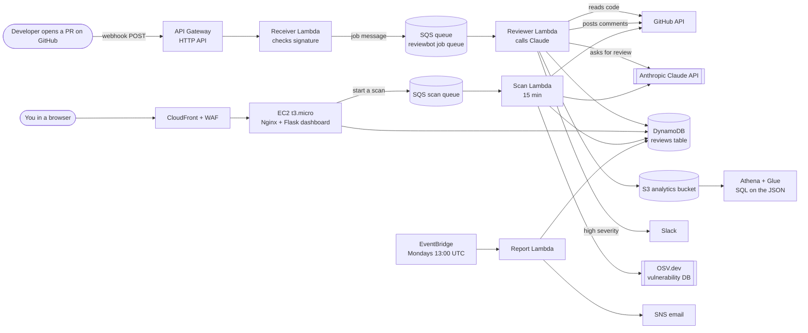
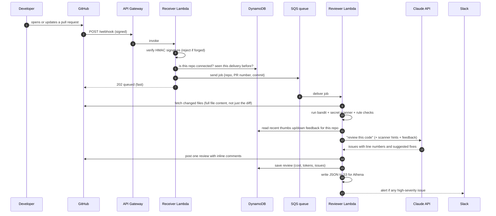
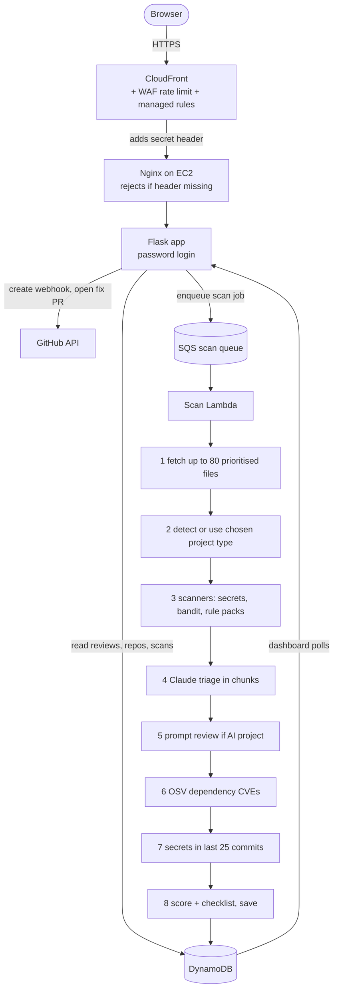
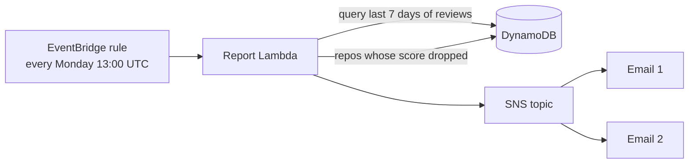
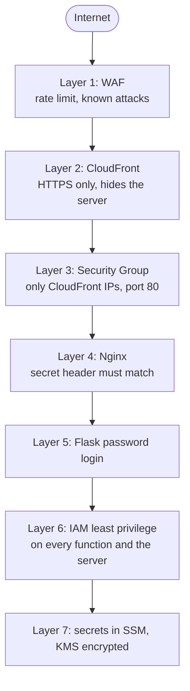
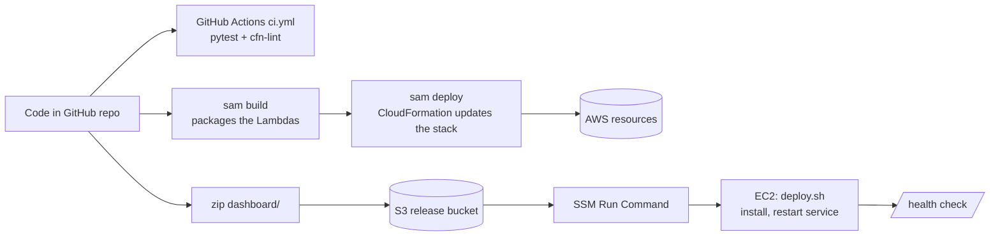

# ReviewBot: the complete project guide

A plain-English walkthrough for the Cloud Computing subject. It explains what the project does, every AWS service in it, why each one was chosen, where it runs, and how a request flows through. The diagrams are Mermaid, so they render on GitHub and in VS Code (Markdown Preview Mermaid extension).

---

## 1. What is ReviewBot, in one paragraph

When a developer opens a **pull request** (a proposed code change) on GitHub, ReviewBot automatically sends the changed code to **Claude** (an AI model). Claude reviews it like a senior engineer: bugs, security problems, bad practice. The comments are posted **back on the pull request**. A **web dashboard** shows every review, its cost, and lets you tune settings. A second feature, **Repo scan**, audits a *whole repository* (not just one PR) and gives it a health score, a checklist, a dependency vulnerability check and, for AI projects, a review of the system prompt.

**Real-life use:** a small team has no time for thorough code review. ReviewBot is a tireless first reviewer that catches leaked passwords, SQL injection and missing tests before a human looks. Companies pay for tools like this (CodeRabbit, Snyk, GitHub Advanced Security). Ours is a small, cheap, self-hosted version.

---

## 2. The big picture

There are **three flows**: (A) the PR review pipeline, (B) the dashboard and Repo scan, (C) the weekly report. Sections 5 to 7 trace each one step by step.

---

## 3. Where everything lives (region and availability zones)

| Item | Value |
|---|---|
| **Region** | `ap-southeast-2` (Sydney). The course account only allows most services here. |
| **Account** | 307326209036 |
| **EC2 dashboard server** | one instance in **ap-southeast-2b** (one AZ: this is the single point of failure, see section 9). |
| **Lambda, SQS, DynamoDB, S3, SNS, API Gateway** | *regional* services. AWS spreads them across **all AZs in the region automatically**, so we do not choose an AZ. |
| **CloudFront** | *global* edge network (price class 200 = most locations except the priciest). |
| **WAF (web firewall)** | must be created in **us-east-1** because CloudFront only accepts WAFs from there. It is made with a CLI script (`scripts/create-waf.sh`) because the course account blocks CloudFormation in us-east-1. |

**Region vs availability zone (AZ):** a *region* is a city-sized area with several separate data centres (*AZs*), each with its own power and network. Services that span AZs survive one data centre failing. Our EC2 box is the exception: if ap-southeast-2b fails, the dashboard is down (reviews still work, because they don't use EC2).

---

## 4. Every AWS service: what, why, in simple terms

### Compute

| Service | In our project | Why this and not something else |
|---|---|---|
| **Lambda: Receiver** (128 MB, 10 s) | Receives the GitHub webhook, verifies it is really from GitHub, drops a job on the queue. | Must answer GitHub within seconds, and runs only when a PR happens. Costs nothing when idle. |
| **Lambda: Reviewer** (256 MB, 3 min) | Fetches the PR files, runs scanners, asks Claude, posts the review, saves results. | A review is a short job. Lambda scales to many PRs at once with no server. |
| **Lambda: Scan** (512 MB, 15 min) | Reads up to 80 files of a whole repo, runs scanners and Claude, checks dependencies and git history. | Longer job, so a longer timeout (15 min is Lambda's maximum). |
| **Lambda: Report** (128 MB, 30 s) | Builds the weekly summary email. | Runs for seconds once a week. |
| **EC2 t3.micro** (Amazon Linux 2023, 8 GB encrypted disk) | Runs Nginx and the Flask dashboard. | The dashboard is a long-lived web app. EC2 shows the "traditional server" side next to the serverless side. |

*Lambda in simple terms:* you upload a function, AWS runs it only when something triggers it, and you pay per millisecond. *EC2 in simple terms:* a rented computer that is always on.

### Messaging and glue

| Service | In our project | Why |
|---|---|---|
| **API Gateway (HTTP API)** | The public URL GitHub calls (`POST /webhook`). Throttled to 2 requests/s (burst 5). | Gives Lambda a public HTTPS address with built-in throttling. |
| **SQS: job queue** | Holds "review this PR" jobs. Visibility timeout 18 min, retried 3 times then moved to the **dead-letter queue (DLQ)**. | **Decouples** receiving from reviewing: GitHub gets a fast "202 queued", the slow Claude work happens separately, and a failure is retried instead of lost. |
| **SQS: DLQ** | Parks jobs that failed 3 times (kept 14 days). A CloudWatch alarm emails us if anything lands here. | Failed jobs are never silently lost. |
| **SQS: scan queue** (`reviewbot-scan-jobs`) | Holds "scan this repo" jobs from the dashboard. Visibility timeout 90 min (6x the Lambda timeout). | The dashboard can answer instantly while the 15-minute scan runs in the background. |
| **EventBridge** | A cron rule `cron(0 13 ? * MON *)` that starts the Report Lambda every Monday 13:00 UTC. | The managed "alarm clock" for AWS. |
| **SNS** | Sends the weekly report and alarm emails. | One topic, many subscribers (we have two emails). |

*A queue in simple terms:* a to-do list between two workers. The first worker adds tasks quickly, the second does them at its own pace. If the second worker crashes, the task stays on the list.

### Data

| Service | In our project | Why |
|---|---|---|
| **DynamoDB** (on-demand) | One table `pk`/`sk` holds reviews, connected repos and their settings, thumbs up/down feedback, GitHub accounts, scans, and webhook delivery IDs. A **TTL** field auto-deletes old items. | No server to manage, pay per request, single-digit-millisecond reads. One table with different "kinds" of item is the standard DynamoDB pattern. |
| **S3: analytics bucket** | Every review is also written as a small JSON file. | Cheap, durable storage Athena can query. Query results expire after 7 days. |
| **S3: release bucket** | Holds the dashboard zip that gets deployed to EC2 (files auto-expire after 30 days). | A staging area between my laptop and the server. |
| **Glue + Athena** | Glue describes the JSON's columns; Athena runs SQL on S3 (e.g. "cost by repo and model", "issues by category"). Capped at 1 GB scanned per query. | Analytics with no database to run. Pay only per query. |
| **SSM Parameter Store (SecureString)** | Holds secrets: Anthropic key, GitHub webhook secret, per-account GitHub tokens, dashboard password, origin secret. Encrypted with KMS. | Secrets stay out of code and out of environment variables. |

### Edge, security and operations

| Service | In our project | Why |
|---|---|---|
| **CloudFront** | HTTPS in front of the dashboard. Adds a secret header `X-Origin-Verify` that Nginx requires. Caching is disabled (it is a live app). | Gives free HTTPS and a stable URL. The EC2 box only accepts traffic from CloudFront. |
| **WAF** | Blocks an IP over 300 requests per 5 minutes, plus AWS's managed rules for common attacks and known-bad inputs. | Stops brute-forcing the dashboard password and common web attacks. |
| **Security Group** | Port 80 only, and only from the CloudFront IP list. | The server is not directly reachable from the internet. |
| **IAM roles** | Each Lambda has its own role with only the permissions it needs (least privilege). The EC2 server has an instance profile. | If one function is hacked, the damage is limited. |
| **SSM Run Command** | Deploys the dashboard to EC2 without SSH keys. | No port 22 open, nothing to leak. |
| **CloudWatch** | Logs for each Lambda (kept 7 days) and three alarms: dead-letter queue not empty, Reviewer Lambda errors, and EC2 status-check failure. | Tells us when something breaks. |
| **AWS Budgets** | Emails at actual spend thresholds ($25, $40, $55). | Protects against runaway cost. |
| **CloudFormation / SAM** | `template.yaml` defines *all* of the above as code. `sam deploy` creates or updates the stack `reviewbot`. | Infrastructure as code: repeatable, reviewable, deletable with one command. |

### Outside AWS

| Service | Used for |
|---|---|
| **GitHub** (webhooks + REST API) | Triggers reviews, supplies code, receives comments, hosts the repo. |
| **Anthropic Claude API** | The AI that reviews code. Haiku (cheap, fast) or Sonnet (smarter, dearer) is selectable per repo. |
| **OSV.dev** | Google's free database of known vulnerable package versions. |
| **Slack** (optional) | Alert when a review finds a high-severity issue. |

---

## 5. Flow A: how a pull request gets reviewed

**Why each step exists**
- *Signature check (2-3):* anyone on the internet could call our URL. GitHub signs each request with a shared secret (HMAC-SHA256). A wrong signature gets `401`. We compare in constant time so attackers cannot guess it byte by byte.
- *Connected-repo check:* only repos you added on the dashboard get reviewed, so strangers cannot make us spend money.
- *Duplicate check:* GitHub sometimes sends the same event twice. A conditional write on `DELIVERY#id` makes the second one a no-op (**idempotency**).
- *Queue:* GitHub expects an answer in about 10 seconds; a Claude review takes much longer. The queue lets us say "got it" immediately and work afterwards.
- *Full-file context:* a diff alone hides surrounding code. Claude sees the whole file but may only comment on changed lines.
- *Scanners before Claude:* deterministic tools (bandit, secret regexes, 30+ rules) are cheap and exact. Their hits go in the prompt so Claude explains and ranks them, and a leaked key is always posted even if Claude misses it.
- *Cost cap:* each repo has a max cost per review; the review stops early and says so.
- *Feedback loop:* thumbs-down on a comment is stored and shown to Claude on the next review of that repo, so it stops repeating that mistake.

---

## 6. Flow B: the dashboard and Repo scan

**What the dashboard does:** connect a GitHub account (token stored encrypted in SSM, never shown again), connect repos (it creates the webhook for you), set model and cost cap per repo, browse and filter reviews, give feedback, start repo scans, view the score trend, and open a "fix PR".

**Project type dropdown** (auto, web app/API, AI/LLM app, infrastructure, library/CLI) decides which rule packs run and what Claude focuses on:

| Pack | Checks |
|---|---|
| generic (always) | secrets, SQL injection (Python/JS/PHP/Java/C#/Go), command injection, `eval`, unsafe deserialisation, TLS off, weak hashes, JWT, path traversal, SSRF, XSS, CORS, cookies |
| ai | user text in the system prompt, model output reaching `eval`/SQL/shell/HTML, agent tools that can change things or auto-approve, secrets in prompts, no max-token limit, no rate limit (mapped to the OWASP LLM Top 10) |
| infra | open CIDR `0.0.0.0/0`, wildcard IAM, public storage, Dockerfile mistakes, GitHub Actions script injection |

**Honest limits:** a static scan reads code, it cannot run your AI app. We grade the system prompt and give a starter `promptfoo` test file, but nobody can *prove* a prompt is injection-proof. Live attack testing of a running endpoint was deliberately left out (SSRF, authorization and cost risks).

**Why a queue between dashboard and scan?** A scan takes up to 15 minutes. The Flask request returns in milliseconds with "queued"; the browser polls for progress. One scan per repo at a time, because every scan costs money.

---

## 7. Flow C: the weekly report

---

## 8. Security design: layers on purpose

Plus: GitHub webhook signature (HMAC), encrypted EBS disk and SQS, S3 public access blocked, no SSH port (deploys use SSM), and a budget alarm. The idea is **defence in depth**: if one layer fails, the next still protects you.

---

## 9. Reliability, scaling and cost (good exam material)

| Question | Answer |
|---|---|
| What if 100 PRs open at once? | Receiver scales out, jobs queue in SQS, Reviewer Lambdas run in parallel (one job each). Nothing is lost. |
| What if Claude's API is down? | The Reviewer fails, SQS retries up to 3 times, then the job goes to the DLQ and an alarm emails us. |
| What if a Lambda crashes? | The message reappears after the visibility timeout and is retried. |
| Single point of failure? | The one EC2 instance in one AZ. A fix would be an Auto Scaling group across 2 AZs behind a load balancer; we did not do this because it costs more and the dashboard is not critical. |
| Does it scale to zero? | Lambda, SQS, DynamoDB, API Gateway and Athena cost almost nothing when idle. EC2 (~$8/month) and WAF are the steady costs. |
| Who pays when it is used? | Claude tokens are the main variable cost: roughly a cent or less per Haiku review. A scan we just ran cost about $0.011. |
| How do we stop overspending? | Per-repo cost cap, one scan per repo at a time, API Gateway throttle, WAF rate limit, and AWS Budgets email alerts. |

**Why "serverless first"?** We only pay while code runs, AWS patches the servers, and it scales automatically. EC2 is used only where a long-running web server is the natural fit.

---

## 10. Deployment: how code gets to AWS

- **CloudFormation** compares your template with what exists and only changes the difference. This is **infrastructure as code**.
- The dashboard is deployed separately because it is not a Lambda: zip to S3, then SSM tells the server to download and restart it.
- A pinned AMI parameter stops a new Amazon Linux release from replacing the server during a deploy.
- Testing: 39 pytest tests using **moto** (a fake AWS in memory), so tests never touch real AWS.

---

## 11. The DynamoDB table in detail

One table, several kinds of item distinguished by the `pk` value:

| pk | sk | What it stores |
|---|---|---|
| `PR#repo#number` | commit sha | marks which commit of a PR was already reviewed |
| `REVIEW` | timestamp#repo#PR | issues, cost, tokens, model, duration |
| `REPOS` | `owner/repo` | connected repo, model, max cost, webhook id, account |
| `FB#owner/repo` | timestamp | thumbs up/down on an issue |
| `GHACCT` | account name | which GitHub token parameter to use |
| `DELIVERY#id` | `-` | webhook dedupe marker, auto-deleted after 7 days (TTL) |
| `SCAN` | timestamp#repo | scan status, score, issues, checklist, prompt review |

**TTL** (`expires_at`) makes DynamoDB delete old items for free, so the table does not grow forever.

---

## 12. Glossary

| Term | Meaning |
|---|---|
| Webhook | GitHub calling *our* URL when something happens. |
| Serverless | You run code without managing servers. |
| Idempotent | Doing it twice has the same effect as once. |
| DLQ | Dead-letter queue: where messages go after repeated failure. |
| HMAC | A signature proving a message came from someone who knows the secret. |
| IAM | AWS's permission system. |
| AZ | Availability zone: one data centre (or group) inside a region. |
| IaC | Infrastructure as code: servers defined in a file. |
| TTL | Time to live: auto-delete after a date. |
| CVE | A publicly known security flaw in software. |
| OWASP | A non-profit publishing the standard lists of web and AI security risks. |
| Prompt injection | Tricking an AI by hiding instructions in its input. |

---

## 13. How to explain the project in two minutes (for your presentation)

1. **Problem:** code review is slow and security mistakes slip through.
2. **Solution:** a bot that reviews every pull request with AI and also audits whole repos.
3. **Architecture:** event-driven and serverless. GitHub webhook, API Gateway, Lambda, SQS queue, a second Lambda calling Claude, results in DynamoDB and S3, a dashboard on EC2 behind CloudFront and WAF.
4. **Why these choices:** queues for reliability, Lambda for pay-per-use scaling, DynamoDB for no-ops storage, SSM for secrets, IAM least privilege, WAF plus CloudFront for protection, CloudFormation for repeatability.
5. **Trade-offs:** one EC2 AZ is a single point of failure; AI findings can be wrong, so deterministic scanners back them up; cost is bounded by caps and budgets.
6. **Cloud concepts shown:** regions and AZs, serverless vs servers, decoupling with queues, retries and DLQs, infrastructure as code, least privilege, encryption, monitoring, cost control.
